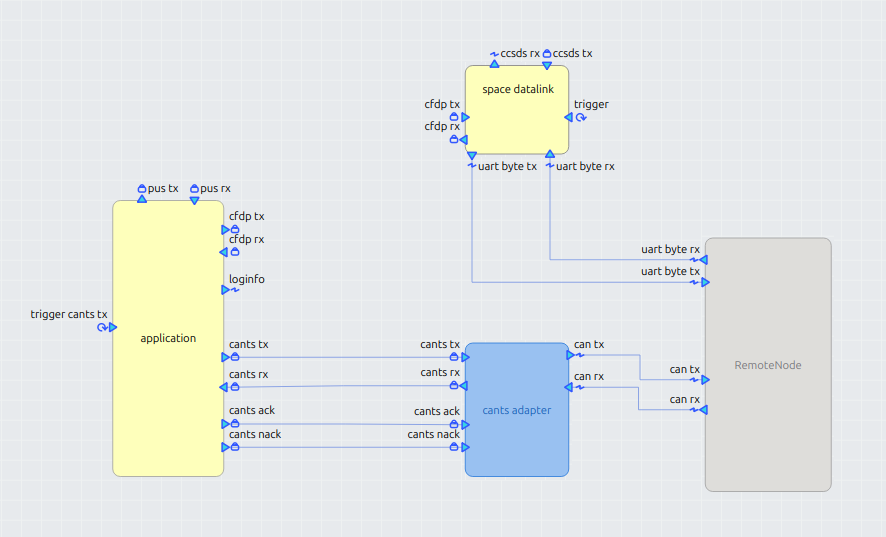

# TASTE-egse-validation

This repository contains a TASTE model in `/model-satll-obc-comms-base`, to run this on an Ubuntu system, enter the project directory and run `taste`.

  

The `space datalink` function will periodically send a dummy CCSDS PUS-C TM[3,25] packet over the UART interface of a SAMV71 Xplained evaluation board. 

The `can-ts` adapter function handles incoming CAN data and formats it to a CAN-TS frame for receiving and transmitting.

Documentation on how to use the model and the EGSE validation results can be found [here](https://github.com/KISPE-Space/mbep-cdr-quickstart/tree/master/documentation).

The referenced repo contains the EGSE software and supporting scripts. This model interfaces to the EGSE via CAN and UART. 

This repository also contains a TASTE model in `/tcpip`, which will periodically send a dummy CCSDS PUS-C TM[3,25] packet over a TCP/IP interface on a host computer which is also running the EGSE software. The EGSE software will need to be reconfgiured to use the `.yaml` file provided in the [TCP/IP documentation](https://github.com/KISPE-Space/mbep-cdr-quickstart/blob/master/documentation/tcp-ip.pdf). 

All of this software is available on Github: https://github.com/KISPE-Space/mbep-cdr-quickstart

  

This software has been developed as part of the "Model Based Execution Platform for Space Applications" project (contract ESA Contract No. 4000146882/24/NL/KK) financed by the European Space Agency.